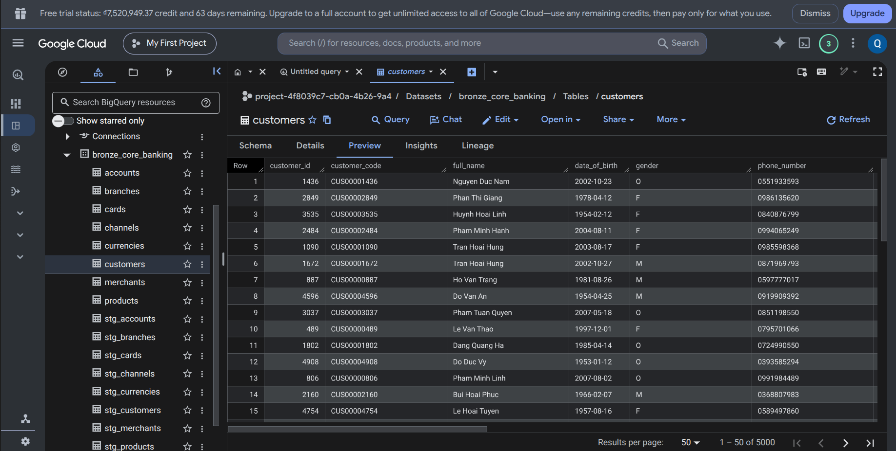

# PostgreSQL → BigQuery: Core Banking Bronze Pipeline

Pipeline đưa dữ liệu ngân hàng từ PostgreSQL lên tầng Bronze của BigQuery. Dữ liệu được đọc theo batch, nạp vào bảng staging, sau đó dùng SQL `MERGE` để cập nhật hoặc thêm bản ghi vào bảng chính.

## Luồng xử lý

1. Tạo dataset BigQuery nếu chưa tồn tại.
2. Tạo bảng chính và bảng staging theo schema khai báo trong SQL.
3. Xóa dữ liệu staging của các bảng được chọn.
4. Đọc toàn bộ dữ liệu PostgreSQL theo batch và append vào staging.
5. Sau khi load thành công tất cả batch, chạy `MERGE` sang bảng chính theo khóa đối chiếu.

Ví dụ: `public.customers` → `bronze_core_banking.stg_customers` → `bronze_core_banking.customers`.

## Công nghệ

- **Python, PostgreSQL, Google BigQuery**
- **psycopg[binary]**: kết nối PostgreSQL, đọc bằng server-side cursor.
- **google-cloud-bigquery**: load dữ liệu và chạy SQL.
- **python-dotenv**: đọc cấu hình từ `.env`.
- **logging, argparse**: ghi log và nhận tham số dòng lệnh.

## Cấu trúc project

```text
PGtoBQ/
├── main.py
├── run.sh
├── requirements.txt
├── .env.example
├── .gitignore
├── etl/
│   ├── extract.py
│   ├── load.py
│   └── logger.py
└── sql/
    ├── 00_create_dataset.sql
    ├── 01_create_tables.sql
    └── 02_merge_tables.sql
```

## Cách chạy

Máy cần có Python 3 và hỗ trợ `venv`.

Tạo file `.env` từ `.env.example`:

```bash
cp .env.example .env
```

Điền thông tin kết nối:

```dotenv
# PostgreSQL
PG_HOST=your-postgres-host
PG_PORT=5432
PG_DATABASE=your-database
PG_USER=your-username
PG_PASSWORD=your-password
PG_SCHEMA=public

# BigQuery
GCP_PROJECT_ID=your-gcp-project-id
BQ_DATASET_ID=bronze_core_banking
BQ_LOCATION=US
GOOGLE_APPLICATION_CREDENTIALS=./credentials/service-account.json

# Pipeline
BATCH_SIZE=5000
LOG_LEVEL=INFO
```

Đặt key service account tại đường dẫn đã cấu hình. Service account cần quyền chạy BigQuery jobs và tạo, đọc, ghi bảng; cần thêm quyền tạo dataset nếu dataset chưa tồn tại. Tài khoản PostgreSQL cần quyền đọc các bảng nguồn.

`BQ_LOCATION` phải khớp vị trí dataset thực tế; `US` là giá trị ví dụ.

Chạy pipeline:

```bash
bash run.sh
```

Script tự tạo `.venv` nếu chưa có, kích hoạt môi trường, cài thư viện và chạy `main.py`. Log được lưu trong folder `logs/`.

## Các bảng và khóa đối chiếu

| Bảng | Khóa dùng trong MERGE |
|---|---|
| accounts | account_id |
| branches | branch_id |
| cards | card_id |
| channels | channel_id |
| currencies | currency_code |
| customers | customer_id |
| merchants | merchant_id |
| products | product_id |
| transaction_status_history | event_id |
| transaction_types | transaction_type_id |
| transactions | transaction_id |

## Vai trò các file SQL

| File | Chức năng |
|---|---|
| `00_create_dataset.sql` | Tạo dataset nếu chưa có |
| `01_create_tables.sql` | Khai báo schema bảng chính và tạo staging tương ứng |
| `02_merge_tables.sql` | Kiểm tra khóa và merge các bảng được chọn |

## Kết quả

